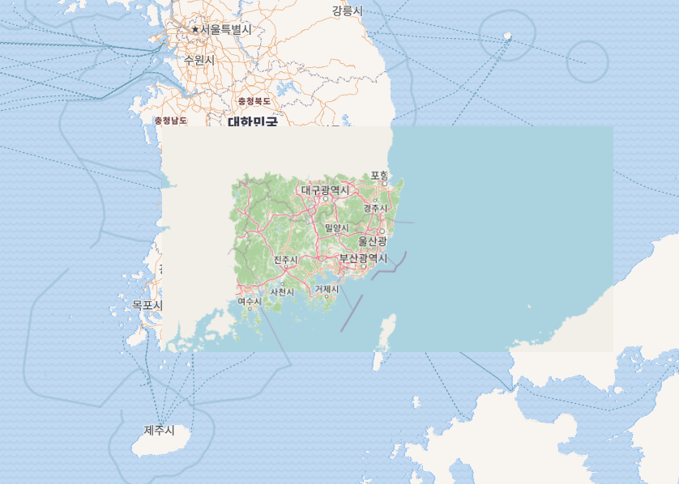

# 한국 오프라인 지도 (폐쇄망용)

인터넷이 없는 **폐쇄망 PC**에서 쓰는 한국 지도. OpenStreetMap 데이터를 미리 타일로 구워 두고,
포터블 서버로 로컬에서 띄운다. 설치·인터넷·외부서버 전부 불필요 — 폴더 하나를 반입해
`실행.bat` 더블클릭이면 브라우저에 지도가 뜬다.

> 데이터 출처: [tiles.osm.kr](https://tiles.osm.kr) 의 `korea-latest-non-military.osm.pbf`



---

## 결과물 한눈에

| 구분 | 범위 | 방식 | 줌 |
|------|------|------|----|
| 전국 개요 | 대한민국 전역 | 벡터 타일 (OpenMapTiles + osm-bright) | z0–14 |
| 부울경 상세 | 부산·울산·경남 | 래스터 타일 (openstreetmap-carto, tiles.osm.kr와 동일 스타일) | z0–18 |

- 부울경 도심(부산·울산·창원·진주·통영·사천·밀양·거제·양산 + 경남 전 군) 은 **z17–18** 까지 구워
  건물 번지·상호명·버스정류장·도로명까지 보인다.
- 라벨은 **한글(name)** 강제. 영어 라벨은 뺐다.
- 좌표계는 Web Mercator(XYZ) — 일반 웹지도와 동일.

### 왜 하이브리드(벡터+래스터)인가
- 전국을 전부 원본급 래스터로 구우면 수십 GB + 수 시간. 그래서 평소 잘 안 보는 전국은
  가벼운 벡터(개요)로, 실제로 자세히 보는 부울경만 원본급 래스터로 구웠다.
- 뷰어에서 부울경 래스터는 `minzoom: 9` 로 두어, 멀리서 전국을 볼 땐 벡터로 균일하게 보이고
  줌인하면 상세 래스터가 켜진다. (래스터 bbox 사각형 경계가 화면 밖으로 빠지는 효과)

---

## 이 저장소에 있는 것 / 없는 것

**있는 것** (소스·스크립트·뷰어·문서)
```
viewer/      웹 뷰어 (MapLibre GL). index.html + 스타일 + 폰트 + 라이브러리 + 실행.bat
tableau/     태블로 연동 (.tms 맵소스 + 타일서버 실행 bat + 사용법)
build/       타일 빌드 스크립트 (Mapnik 병렬 렌더 등)
docs/        스크린샷
STATE.md     작업 로그 (결정/함정 기록 포함)
```

**없는 것** (`.gitignore` — GitHub 100MB 제한 초과)
- `*.pmtiles` : 실제 타일 데이터 (`busangyeong.pmtiles` 1.45GB, `korea.pmtiles` 483MB)
- `*.exe` : `miniserve.exe`(포터블 웹서버), `pmtiles.exe`(태블로용 타일서버)
- 원본 `*.osm.pbf`, 중간 `*.mbtiles`

→ 데이터·바이너리는 아래 **빌드 과정**대로 다시 만들거나, 사내에 따로 공유한
   `korea-map.zip`(완성 배포본, ~2GB)을 받아서 쓴다.

---

## 폐쇄망 배포 방법 (받는 사람용)

1. `korea-map.zip` (완성 배포본) 을 폐쇄망 PC로 반입 후 압축 해제.
2. 폴더 안의 **`실행.bat`** 더블클릭 → 서버가 뜨고 잠시 후 브라우저에 지도.
   - "연결 거부"가 떠도 2~3초 뒤 F5 새로고침하면 된다(서버 기동 대기).
3. 검은 창은 지도 서버다. 다 보면 그때 닫는다.

> 배포 폴더 = 이 저장소의 `viewer/` 내용 + `busangyeong.pmtiles` + `korea.pmtiles` + `miniserve.exe`
> 를 한 폴더에 모은 것.

---

## 태블로(Tableau) 배경지도로 쓰기

웹뷰어(MapLibre)는 태블로가 직접 못 읽으므로, pmtiles 를 XYZ 타일서버로 띄워서 붙인다.

1. `pmtiles.exe serve . --port 8788 --cors "*"` 실행 (= `tableau/태블로_타일서버.bat`).
2. `tableau/부울경.tms` 를 `Documents\My Tableau Repository\Mapsources` 에 복사, 태블로 재시작.
3. 태블로에서 `Map > Background Maps > 부울경 상세지도(OSM)` 선택.

- 타일 URL: `http://localhost:8788/busangyeong/{Z}/{X}/{Y}.png`
- `class="OpenStreetMap"`(XYZ) 라 Y축 뒤집힘 없음.
- **태블로 서버 게시 시**: `부울경.tms` 의 `server="http://localhost"` 를 타일서버가 도는
  사내 PC IP로 바꾼다. 자세한 건 `tableau/태블로_사용법.txt`.
- 한계: 부울경 범위만 들어 있어 그 바깥은 빈 화면.

---

## 빌드 과정 (처음부터 다시 만들 때)

WSL2 Ubuntu 기준. GPU 불가(Mapnik=CPU 래스터).

### 1) 전국 벡터 타일 — `korea.pmtiles`
[planetiler](https://github.com/onthegomap/planetiler) 로 OMT 스키마 벡터타일 생성.
```bash
java -jar planetiler.jar --osm-path=korea-latest.osm.pbf --output=korea.pmtiles --maxzoom=14
```

### 2) 부울경 래스터 스택 설치 (sudo)
```bash
sudo apt install postgresql-16 postgis osm2pgsql osmium-tool nodejs npm \
                 python3-mapnik gdal-bin fonts-noto-cjk fonts-unifont
sudo npm install -g carto
```
- **주의**: `python3-mapnik` 은 시스템 `python3.12` 전용. 항상 `/usr/bin/python3.12` 로 실행.

### 3) PostGIS 적재 + carto 컴파일
```bash
# 부울경만 추출
osmium extract -b 127.5,34.4,129.6,36.05 korea-latest.osm.pbf -o busan_region.osm.pbf
# DB 적재 (최신 carto = flex 방식)
osm2pgsql -d gis -O flex -S openstreetmap-carto/openstreetmap-carto-flex.lua busan_region.osm.pbf
# 외부데이터(water/icesheet) + 함수/공통값 — 안 하면 carto_pois relation 에러
cd openstreetmap-carto && python3 scripts/get-external-data.py
psql -d gis -f functions.sql -f indexes.sql
# 스타일 컴파일
carto project.mml > mapnik.xml
```

### 4) 래스터 렌더 → mbtiles → pmtiles
```bash
# 부울경 전역 z0-16
/usr/bin/python3.12 build/render_parallel.py mapnik.xml busangyeong.mbtiles 127.5 34.4 129.6 36.05 0 16 30
# 도시 중심부 z17-18 덧대기 (부산·울산·창원권)
bash build/render_cities_1718.sh
# 경남 전 시군 z17-18
bash build/render_gyeongnam_1718.sh
# mbtiles 병합(파이썬 ATTACH + INSERT OR REPLACE, maxzoom=18) 후 변환
pmtiles convert busangyeong.mbtiles busangyeong.pmtiles
```
`render_parallel.py` = 30워커 병렬 렌더(~70 t/s). 인자: `<mapnik.xml> <out.mbtiles> minlon minlat maxlon maxlat minz maxz [nproc]`

### 5) 뷰어 조립
`viewer/` + `busangyeong.pmtiles` + `korea.pmtiles` + `miniserve.exe` 를 한 폴더에.
`index.html` 이 전국 벡터 위에 부울경 래스터를 오버레이하고, 라벨을 한글로 강제한다.

---

## 함정 메모 (겪은 것들)
- `.bat` 은 **CP949** 로 저장해야 한국어 윈도우 cmd 에서 안 깨진다. UTF-8 로 저장하면
  한글이 깨져 명령어로 잘못 실행됨.
- `실행.bat` 은 서버를 **먼저** 띄우고 브라우저를 나중에 열어야 함. 반대면 "연결 거부".
- 뷰어 pmtiles URL 은 절대경로(`location.origin`)로. 헤드리스 크롬 검증 시
  `--virtual-time-budget` 쓰면 빈화면(404 로그로 검증).
- `pmtiles serve` URL = `/<아카이브명>/{z}/{x}/{y}.png` (아카이브명 = 파일명에서 `.pmtiles` 뺀 것).
- 자세한 결정/함정 기록은 `STATE.md`.

---

## 출처 / 라이선스
- 지도 데이터: © OpenStreetMap contributors (ODbL)
- 스타일: [openstreetmap-carto](https://github.com/gravitystorm/openstreetmap-carto), [osm-bright](https://github.com/openmaptiles/osm-bright-gl-style)
- 도구: [planetiler](https://github.com/onthegomap/planetiler), [MapLibre GL JS](https://github.com/maplibre/maplibre-gl-js), [PMTiles](https://github.com/protomaps/PMTiles), [miniserve](https://github.com/svenstaro/miniserve), Noto Sans
